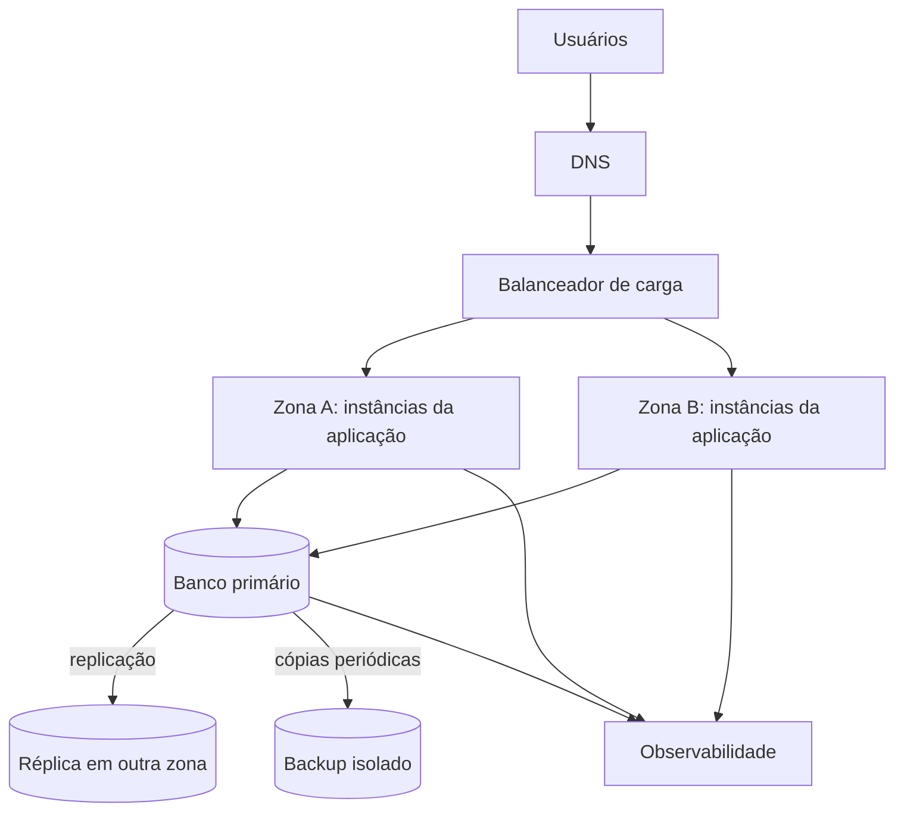
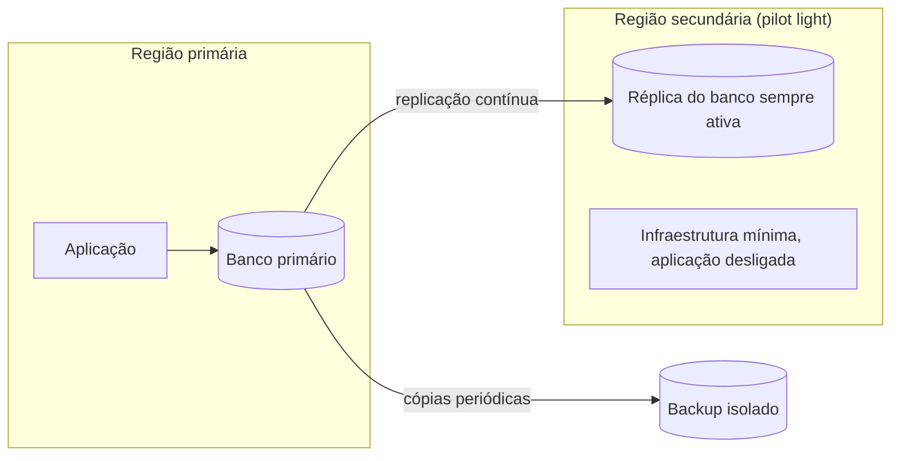

# 02 — Alta Disponibilidade, Resiliência e Recuperação de Desastres

## 1. Objetivo

Definir como o sistema de biblioteca continua disponível diante de falhas locais (instância, zona) e como é recuperado em eventos graves (perda de ambiente, região ou dados), respeitando o limite de 5 minutos de indisponibilidade do cenário.

## 2. Arquitetura Proposta

| Componente | Função |
|------------|--------|
| DNS | Encaminha os usuários ao balanceador |
| Balanceador de carga | Distribui requisições apenas para instâncias saudáveis |
| Zonas A e B | Instâncias da aplicação em zonas diferentes, para que a falha de uma zona não derrube o serviço |
| Banco primário e réplica | Banco compartilhado entre as versões; a réplica fica em outra zona |
| Backup isolado | Cópia fora do ambiente que protege |
| Observabilidade | Coleta métricas, logs e traces (ver [01](01-observabilidade.md)) |

**Relação com o T6:** o deploy Blue/Green continua sendo o mecanismo de entrega. Blue e Green são dois conjuntos de instâncias atrás do mesmo balanceador, compartilhando o banco.

## 3. Pontos Únicos de Falha

Componentes redundantes não garantem uma arquitetura disponível: a disponibilidade depende de toda a cadeia (DNS, rede, banco, dependências e operação).

| Ponto de falha | Risco | Mitigação |
|----------------|-------|-----------|
| Instância da aplicação | Perda de capacidade | Mínimo de duas instâncias, em zonas diferentes; o balanceador remove a instância doente |
| Zona de disponibilidade | Perda de metade da capacidade | Instâncias distribuídas em Zona A e Zona B |
| **Banco primário** | Sistema inteiro fora, pois o banco é compartilhado | Réplica em outra zona com failover (ver seção 4) |
| Balanceador de carga | Nenhum acesso ao serviço | Balanceador redundante ou serviço gerenciado com alta disponibilidade |
| DNS | Usuários não encontram o serviço | Provedor com redundância |
| Estado de sessão guardado na instância | Usuário perde a sessão se a instância cair | Sessão em armazenamento compartilhado |
| Procedimento manual não testado | Recuperação lenta | Runbook testado (ver [03](03-runbook-e-riscos.md)) |

O **banco compartilhado** é o ponto mais crítico: ele já era o principal risco do T6 e continua sendo o centro do plano de HA e DR.

## 4. Alta Disponibilidade e Failover

- **Redundância:** instâncias em duas zonas e banco com réplica.
- **Detecção:** health checks de readiness (aplicação pronta e banco acessível) alimentam o balanceador e os alertas A1–A3.
- **Failover da aplicação:** automático; o balanceador deixa de enviar tráfego à instância reprovada no readiness.
- **Failover do banco:** a réplica assume o papel de primário. Pode ser automático ou manual; para o planejamento considera-se o pior caso, **manual guiado pelo runbook**, que precisa caber nos 5 minutos.
- **Teste:** um failover que nunca foi testado é apenas uma hipótese. Ele deve ser executado em ambiente controlado, medindo o tempo real (seção 10).
- **Custo:** alta disponibilidade aumenta custo e complexidade; a proposta se limita ao necessário para o limite de 5 minutos.

## 5. Escalabilidade e Balanceamento

| Característica | Vertical | Horizontal |
|----------------|----------|-----------|
| O que faz | Aumenta recursos de uma instância | Aumenta o número de instâncias |
| Simplicidade | Simples de aplicar | Exige distribuição de tráfego |
| Limite | Físico ou comercial | Controlado por política |
| Reinicialização | Pode exigir | Não necessária |
| Redundância | Mantém concentração de falha | Favorece redundância |

**Escolha: escalabilidade horizontal**, porque ela combina com o objetivo de alta disponibilidade e com o pico de uso do início do semestre. Para isso, a aplicação não pode guardar estado local (sessões ficam em armazenamento compartilhado).

**Política de autoscaling**

| Parâmetro | Definição |
|-----------|-----------|
| Sinais | Requisições, latência e CPU |
| Mínimo | Duas instâncias (uma por zona), pois menos que isso elimina a redundância |
| Máximo | Definido pelo orçamento, para evitar custo descontrolado |
| Cooldown | Calibrado em teste de carga, considerando o tempo de inicialização da aplicação |
| Pico do semestre | Aumentar a capacidade **antes** do início do semestre, sem esperar o autoscaling reagir |

O comportamento deve ser testado sob carga antes do período de pico.

## 6. Resiliência

Resiliência é manter ou recuperar a função diante de falhas, controlando o efeito de cada falha.

| Prática | Aplicação no sistema |
|---------|----------------------|
| Timeout | Limitar o tempo de espera por banco ou dependências, para não prender requisições |
| Retry com limite e backoff | Repetir operações de leitura com número máximo de tentativas e espera crescente; repetir sem controle amplifica o incidente |
| Circuit breaker | Interromper chamadas a uma dependência que está falhando e retomar aos poucos |
| Bulkhead | Isolar recursos para que a lentidão em uma função (por exemplo, relatórios) não afete empréstimos |
| Degradação graciosa | Se a escrita no banco falhar, manter a consulta ao catálogo disponível e avisar que empréstimos estão temporariamente indisponíveis |
| Idempotência nas operações de empréstimo | Evitar que uma repetição crie empréstimos duplicados (risco já identificado nos smoke tests do T6) |

## 7. RPO e RTO

- **RPO** (Recovery Point Objective): quantidade máxima aceitável de dados perdidos.
- **RTO** (Recovery Time Objective): tempo máximo desejado para restaurar o serviço.

| Cenário | RPO | RTO | Justificativa |
|---------|-----|-----|---------------|
| Falha local (instância, zona ou banco primário com réplica saudável) | Praticamente zero, limitado ao atraso de replicação, que é monitorado no painel | Até 5 minutos | O limite de indisponibilidade do cenário é 5 minutos, então o failover precisa caber nele |
| Desastre (perda do ambiente, da região ou corrupção de dados) | 15 minutos | 1 hora | Empréstimos são registros pequenos e, com cópias a cada 15 minutos, as operações perdidas podem ser reconstruídas e conferidas; uma biblioteca tolera 1 hora de restauração se o evento for raro, e prazos menores exigiriam DR mais cara |

**Coerência com a cópia de dados:** o RPO de 15 minutos exige replicação contínua ou backups com intervalo de no máximo 15 minutos. Um backup diário não atenderia a esse RPO.

**Observação:** RTO menor costuma custar mais. Os valores de desastre (15 minutos e 1 hora) seguem os exemplos da aula e são metas propostas, a serem confirmadas com a biblioteca.

## 8. Estratégia de Recuperação de Desastres

| Estratégia | Recuperação | Custo | Atende RPO 15 min e RTO 1 h? |
|------------|-------------|-------|------------------------------|
| Backup e restore | Mais lenta | Baixo | Risco: restaurar o banco e recriar o ambiente pode passar de 1 hora |
| **Pilot light** | Moderada | Médio-baixo | **Sim, se a réplica estiver sempre ativa e o ambiente puder ser criado por automação** |
| Warm standby | Rápida | Médio-alto | Atende, mas é mais cara do que o impacto exige |
| Active-active | Muito rápida | Alto | Atende, mas é desproporcional para uma biblioteca |

**Escolha recomendada: pilot light.** O banco é replicado de forma contínua para uma região secundária, onde fica uma infraestrutura mínima; em caso de desastre, a aplicação é criada e ligada nessa região. Ela equilibra custo e prazo. Se o orçamento for muito restrito, **backup e restore** é a alternativa mais barata, mas o RTO de 1 hora ficaria em risco.

**Em caso de desastre:** declarar o desastre, ligar a aplicação na região secundária, promover a réplica, redirecionar o DNS, validar com os smoke tests do T6 e comunicar as partes. A restauração de dados com risco de perda segue o procedimento do plano de rollback do T6 (análise e autorização do responsável pelos dados).

DR envolve também pessoas, processos, comunicação e testes, não apenas tecnologia.

## 9. Backup Confiável

Backup é parte do plano de DR, não o plano completo. Para ser confiável, o backup do sistema deve:

- [ ] ter escopo definido (banco e configuração versionada);
- [ ] ser criptografado;
- [ ] ter retenção definida e cópias isoladas;
- [ ] ser monitorado (alerta se uma cópia falhar);
- [ ] ter a restauração testada;
- [ ] atender ao RPO de 15 minutos;
- [ ] não depender apenas do mesmo ambiente que protege.

## 10. Testes de Resiliência

Começam em ambiente controlado e medem o tempo real de recuperação.

| Teste | O que valida |
|-------|--------------|
| Desligar uma instância | O balanceador redireciona e o usuário não percebe |
| Simular a perda de uma zona | O serviço continua com a outra zona |
| Executar o failover do banco | Tempo real versus o RTO de 5 minutos |
| Restaurar um backup | O RPO de 15 minutos e o RTO de 1 hora são alcançáveis |
| Forçar os alertas A1–A3 | Os alertas disparam e levam à ação correta |
| Percorrer o runbook | O procedimento é executável sob pressão |
| Teste de carga no pico | O autoscaling reage a tempo |
