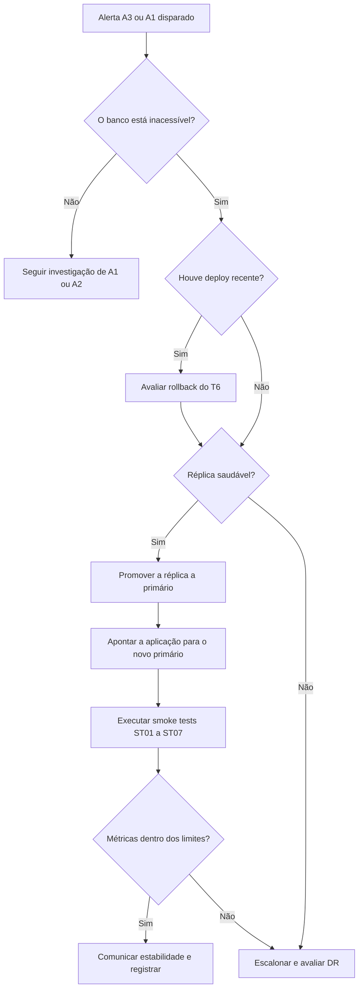

# 03 — Runbook, Riscos e Justificativas

## 1. Runbook: Banco de Dados Primário Indisponível

Falha escolhida: o banco primário compartilhado fica indisponível. É o pior ponto único de falha do sistema (ver [02](02-alta-disponibilidade-dr.md), seção 3). Meta de recuperação: até **5 minutos** (RTO de falha local).

| Campo | Conteúdo |
|-------|----------|
| **Sintoma** | Alerta A3 (readiness reprovado por falta de acesso ao banco), erros de conexão nos logs e aumento da taxa de erros (A1) |
| **Verificações** | 1. Confirmar no painel o estado do banco primário e da réplica. 2. Verificar nos logs os erros de conexão. 3. Checar nos marcadores de deploy se houve mudança recente. 4. Confirmar que a réplica está saudável e com pouco atraso de replicação. |
| **Ações seguras** | 1. Promover a réplica a primário. 2. Apontar a aplicação para o novo primário. 3. Executar os smoke tests ST01–ST07 do [plano de deploy do T6](https://github.com/bel1020304050/Atividade-CD-Deploy-Rollback-). 4. Monitorar erros e latência até voltarem aos limites. |
| **Escalonamento** | Responsável pelo banco de dados; depois, responsável pelo deploy. Se a réplica não estiver saudável ou houver risco de perda ou corrupção de dados, avaliar o plano de DR |
| **Reversão** | Manter o primário original isolado até a investigação, para evitar que dois bancos aceitem escritas ao mesmo tempo. Se houve deploy recente e ele for a causa, aplicar o rollback do T6 |
| **Comunicação** | Avisar a equipe; informar o responsável pelo sistema e os usuários afetados; registrar horário de início, impacto e versão; comunicar quando o serviço estiver estável |
| **Encerramento** | Smoke tests aprovados, métricas dentro dos limites, integridade dos dados conferida (inclusive empréstimos feitos durante a falha) |
| **Depois** | Registrar o incidente e a causa, medir o tempo real de recuperação e atualizar o runbook. O foco durante a crise é recuperar, e não buscar culpados |

Assume-se failover do banco manual (pior caso). Se ele for automatizado, a plataforma executa a promoção e o apontamento, e o runbook passa a validar e comunicar.

## 2. Riscos e Mitigações

| Risco | Impacto | Mitigação |
|-------|---------|-----------|
| Banco primário como ponto único de falha | Sistema inteiro fora | Réplica em outra zona, failover testado e runbook |
| Dois bancos aceitando escrita (split-brain) após o failover | Dados divergentes | Isolar o primário original até a investigação |
| Atraso de replicação maior que o RPO | Perda de dados acima do tolerado | Monitorar o atraso no painel e alertar quando ele se aproximar do RPO |
| Retry sem controle | Amplifica o incidente | Retry com limite e backoff, circuit breaker |
| Pico do semestre sem capacidade | Lentidão ou queda no momento de maior uso | Ampliar capacidade antes do semestre e testar carga |
| Autoscaling lento para o tempo de inicialização | Capacidade insuficiente no início do pico | Definir mínimo adequado e calibrar o cooldown em teste |
| Backup nunca restaurado | RPO e RTO de DR não comprovados | Testes periódicos de restauração |
| Failover nunca testado | RTO de 5 minutos é apenas hipótese | Executar e medir o failover em ambiente controlado |
| Fadiga de alertas | Alertas ignorados | Alertar por sintoma, com ação e responsável definidos |
| Custo da alta disponibilidade | Orçamento ultrapassado | Limitar a redundância ao necessário e definir o máximo de instâncias |
| Runbook desatualizado | Resposta lenta sob pressão | Revisar após cada incidente e a cada mudança de arquitetura |

## 3. Justificativas das Principais Decisões

| Decisão | Por quê |
|---------|---------|
| Operação crítica: empréstimo e devolução | É a funcionalidade central do sistema e a que mudou na versão 1.1.0 do T6 |
| SLO de 99,9% em 30 dias | Valor de referência da aula; deixa cerca de 43 minutos de orçamento, compatível com incidentes de até 5 minutos |
| SLO de latência: 95% abaixo de 1 segundo | Mantém a exigência de p95 inferior a 1 segundo definida no T6 |
| Alertas por sintoma | Medem impacto ao usuário e evitam ruído de métricas internas isoladas |
| Alta disponibilidade em duas zonas | Resiste à falha de uma zona sem custo de multirregião |
| Escalabilidade horizontal | Combina com redundância e com o pico do início do semestre |
| RTO de 5 minutos para falha local | É o limite de indisponibilidade do cenário |
| RPO de 15 min e RTO de 1 h para desastre | Equilíbrio entre impacto (baixo, em uma biblioteca) e custo da estratégia |
| DR em pilot light | Atende RPO e RTO com custo menor do que warm standby e active-active |
